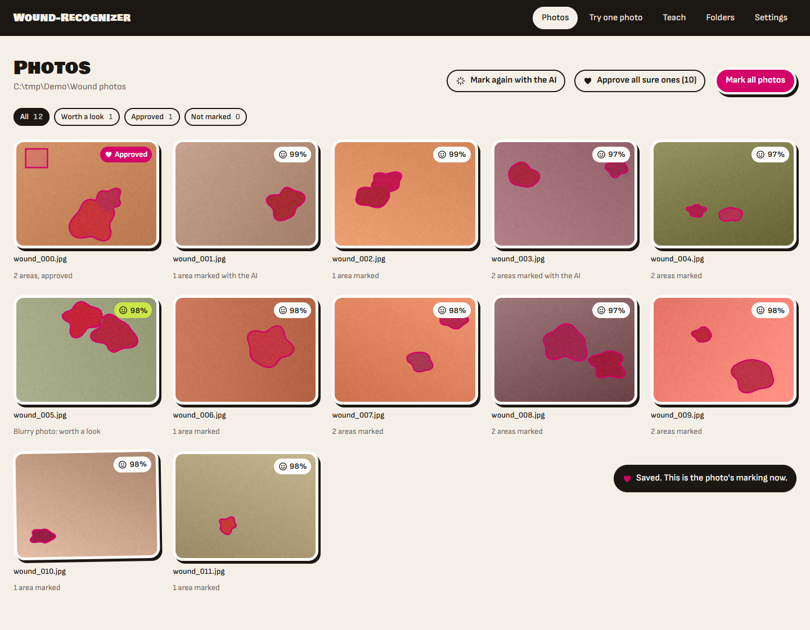
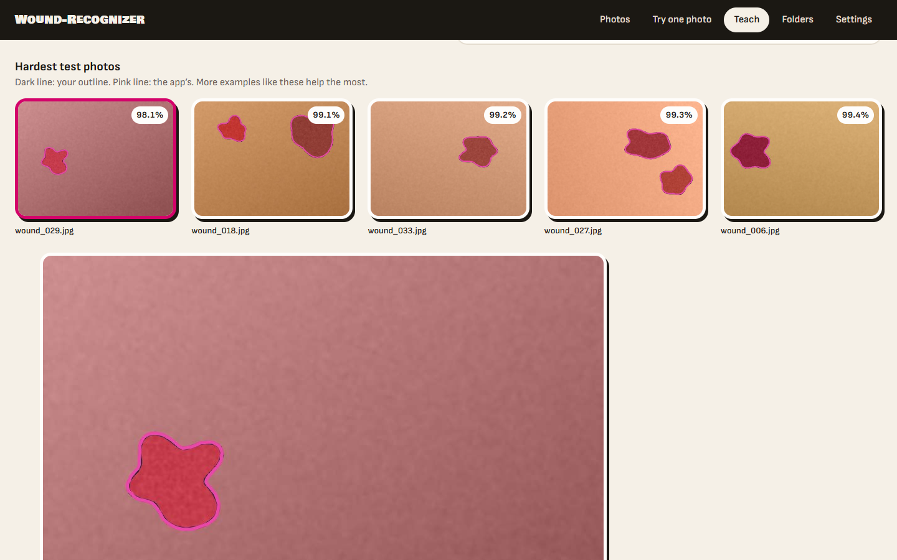
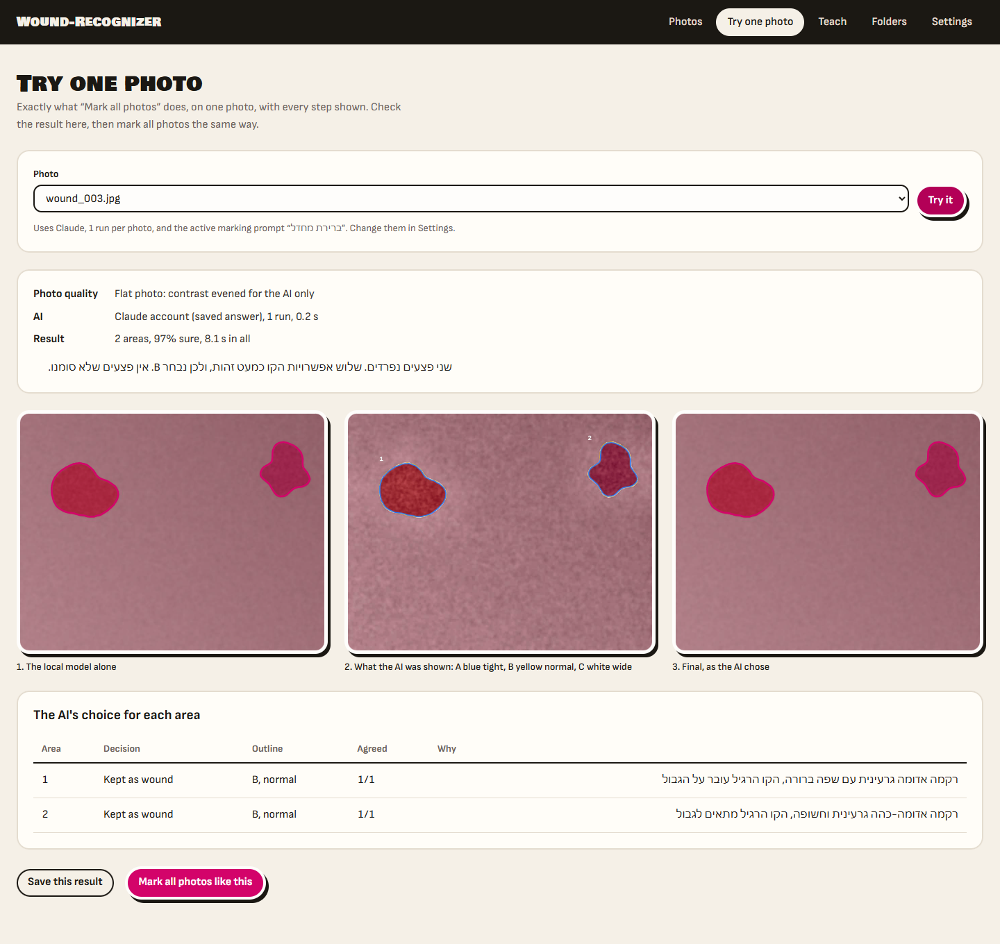
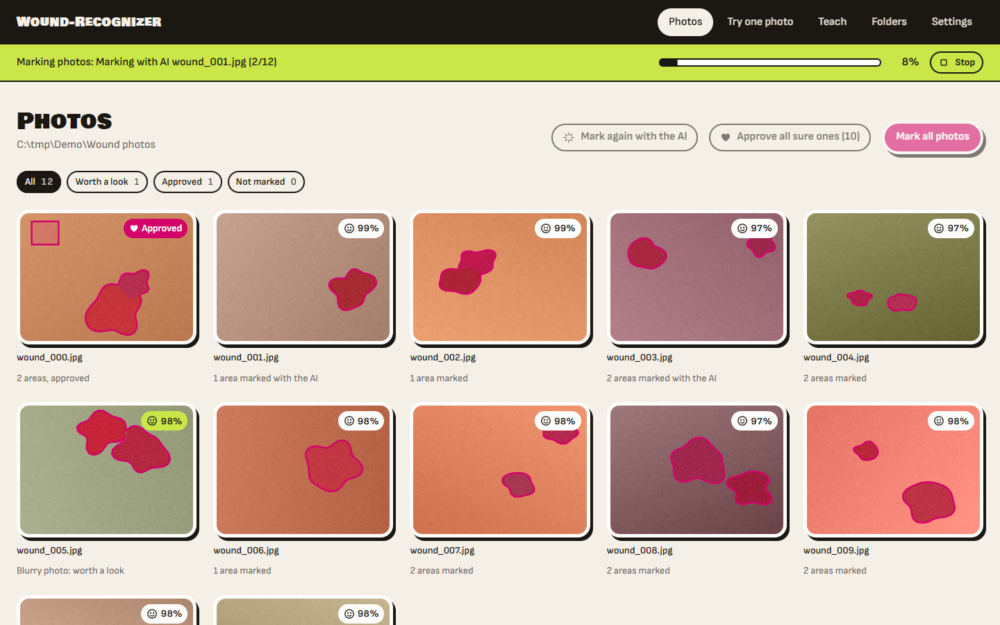
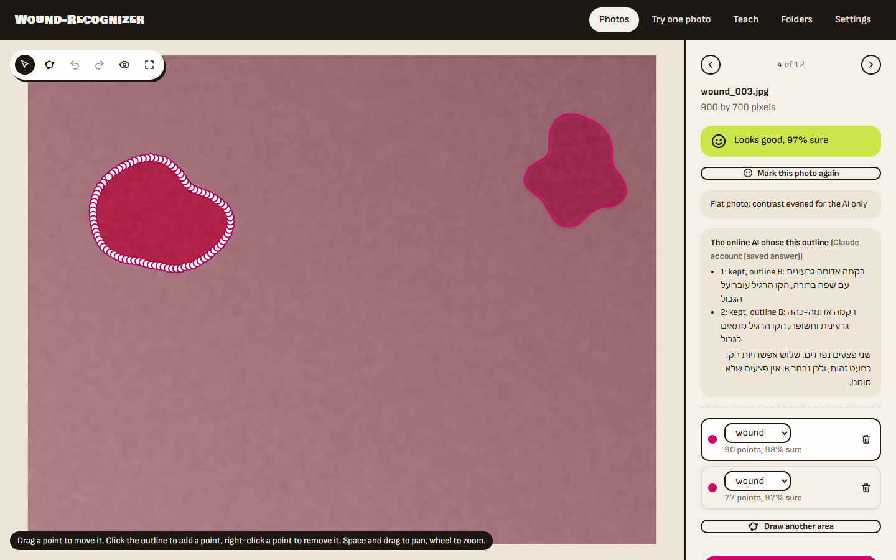
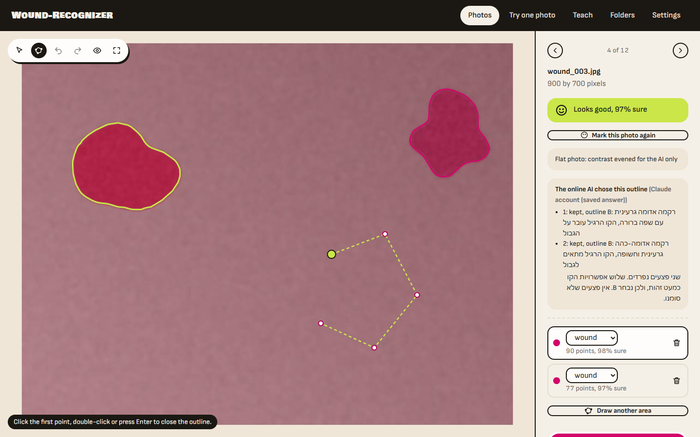
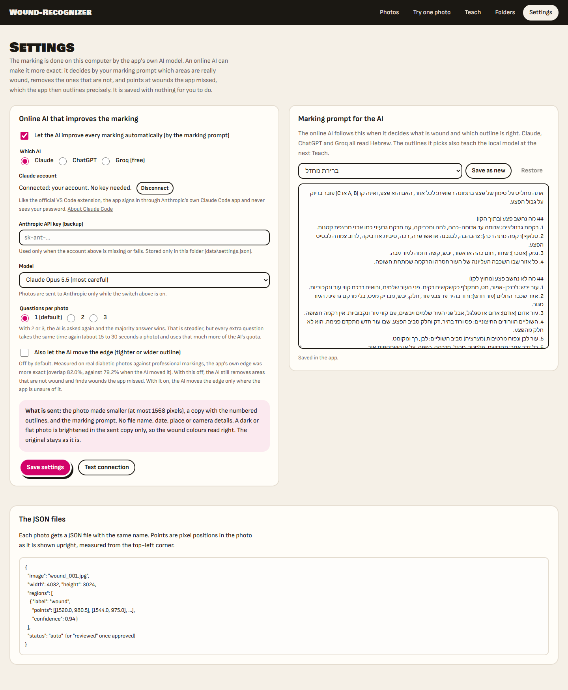
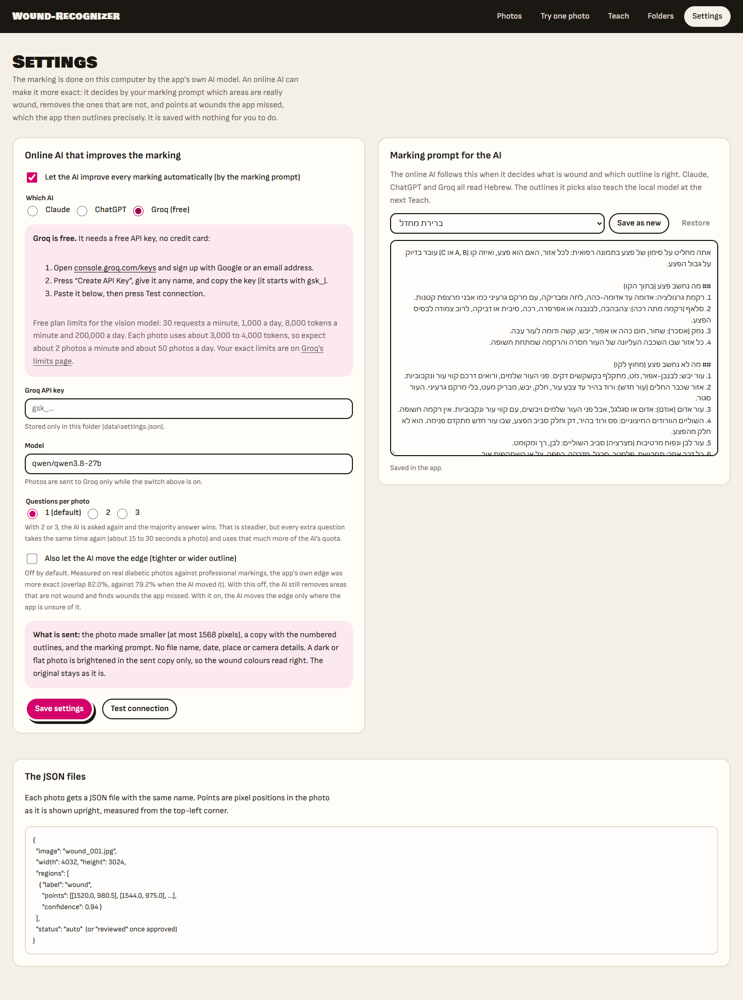

<div dir="rtl">

# Wound-Recognizer

## מה זה?

- נותנים לתוכנה תיקייה של תמונות פצעים.
- התוכנה מציירת קו נקודות מסביב לכל פצע.
- לכל תמונה נשמר קובץ JSON עם אותו שם, מוכן להכנסה לאפליקציה הרפואית.
- התוכנה לומדת מהדוגמאות שכבר סימנת, ומכל תיקון שלך היא משתפרת.
- הכול עובד על המחשב שלך, גם בלי אינטרנט. שום תמונה לא יוצאת מהמחשב, אלא אם מפעילים את ה-AI החיצוני (סעיף 8).

### בקצרה, טכנית

הזיהוי עצמו הוא AI מקומי: רשת נוירונים שרצה על המחשב. ה-AI החיצוני, אם מפעילים אותו, משפר את הדיוק לפי ההוראות שכתבת. הוא לא מצייר נקודות, אלא בוחר בין קווים מדויקים שהמודל המקומי צייר.

| רכיב | מה הוא | על מה הוא אחראי |
|---|---|---|
| מודל הסגמנטציה | U-Net עם מקודד EfficientNet-B4 ברזולוציה 768 על כרטיס NVIDIA, או ResNet34 ברזולוציה 512 על מעבד. המקודד מאומן מראש על ImageNet. | מסווג כל פיקסל: פצע או לא פצע. |
| האימון | כיוונון עדין (fine-tune) על הדוגמאות, התיקונים שלך והקווים שה-AI החיצוני בחר: Cross-Entropy + Dice, AdamW, אוגמנטציות של תאורה, צבע, טשטוש, סיבוב וזווית. | מתאים את המודל לסימון שלך. |
| הבדיקה | קבוצת תמונות שסימנת בעצמך, שהמודל לא מתאמן עליהן, ומדד IoU. | מודל חדש מחליף את הקודם רק אם הוא לא פחות טוב. |
| מנוע ההרצה | PyTorch CUDA על NVIDIA, ONNX Runtime (DirectML) על כל כרטיס אחר, אחרת מעבד. | מריץ את המודל במהירות על החומרה שיש. |
| עיבוד גאומטרי | OpenCV: מסכה לקווי מתאר, החלקה ומרווח נקודות כמו בדוגמאות שלך. | הופך את המסכה לנקודות ב-JSON. |
| בדיקת איכות | OpenCV: בהירות, ניגודיות וחדות. | מסמנת תמונה מטושטשת, ומבהירה תמונה חשוכה רק בעותק שנשלח ל-AI. |
| AI חיצוני (לא חובה) | Claude, ChatGPT או Groq, דרך חשבון או מפתח API. | מחליט לכל אזור, לפי ההוראות, אם הוא פצע; מוחק אזורים שאינם פצע ומצביע על פצע שפוספס. לא חובה: גם להזיז את הקו. |

**ה-FLOW של כל תמונה:**

1. בדיקת איכות: תמונה חשוכה, שטוחה או מטושטשת.
2. המודל המקומי רואה את כל התמונה, וגם את היפוכיה (TTA).
3. כל פצע שנמצא נחתך עם שוליים ונבדק שוב ברזולוציה מלאה, לקצוות מדויקים.
4. מכל אזור יוצאים שלושה קווים מדויקים: **A** צמוד, **B** רגיל, **C** רחב.
5. אם ה-AI החיצוני פעיל: הוא מקבל את התמונה, את האפשרויות ממוספרות ואת ההוראות, ומחליט לכל אזור להשאיר או למחוק. אם הוא מצביע על פצע שפוספס, המודל המקומי מצייר לו קו מדויק. הקו עצמו נשאר של המודל המקומי, אלא אם מפעילים בהגדרות שגם ה-AI יזיז אותו.
6. עם 2 או 3 הרצות נלקחת תשובת הרוב.
7. נשמר JSON, בלי שום פעולה ממך. אם ה-AI לא ענה, נשמר הקו המקומי.
8. התיקונים שלך והבחירות של ה-AI נכנסים לאימון הבא.

---

## 1. הורדה

יש שתי דרכים. בוחרים אחת.

**דרך א: קובץ ZIP**

1. בדף הזה לוחצים על הכפתור הירוק **Code**, ואז על **Download ZIP**.
2. לוחצים על קובץ ה-ZIP עם הכפתור הימני, בוחרים **חילוץ הכל** (Extract All), ושמים את התיקייה איפה שנוח, למשל במסמכים.

**דרך ב: Git** (נוח לעדכונים)

צריך Git במחשב. כדי לבדוק אם הוא מותקן, כותבים בטרמינל `git --version`. אם מופיעה שגיאה, מתקינים אותו מ-https://git-scm.com/download/win

1. בדף הזה לוחצים על הכפתור הירוק **Code** ומעתיקים את הכתובת שמופיעה תחת **HTTPS**.
2. פותחים טרמינל (PowerShell) בתיקייה שבה רוצים את התוכנה, וכותבים:
   ```
   git clone <הכתובת שהעתקת>
   ```
3. **לעדכן לגרסה החדשה** בכל פעם: נכנסים לתיקיית התוכנה וכותבים:
   ```
   git pull
   ```

## 2. התקנה (פעם אחת בלבד)

1. **רק אם Python עוד לא מותקן במחשב**, מתקינים אותו.
   - **לבדוק אם הוא מותקן:** פותחים טרמינל (PowerShell) וכותבים:
     ```
     python --version
     ```
     אם מופיע מספר גרסה, למשל `Python 3.11.9`, הוא כבר מותקן ומדלגים לשלב 2. אם מופיעה שגיאה, או שנפתחת חנות Microsoft, צריך להתקין.
   - **להתקין:** מורידים מ-https://www.python.org/downloads/
   - **חשוב:** במסך הראשון של ההתקנה מסמנים את התיבה **Add python.exe to PATH**, ורק אז לוחצים Install.
2. נכנסים לתיקיית התוכנה ולוחצים פעמיים על **start.bat**.
3. בפעם הראשונה נפתח חלון שחור שמתקין את כל מה שצריך. זה לוקח בערך 10 עד 20 דקות וצריך אינטרנט. מחכים עד שהוא מסיים.

## 3. הפעלה (כל פעם)

1. לוחצים פעמיים על **start.bat**.
2. התוכנה נפתחת לבד בדפדפן. אם היא לא נפתחה, נכנסים לכתובת http://127.0.0.1:8765
3. **לא סוגרים את החלון השחור** כל עוד עובדים. כשמסיימים, סוגרים אותו.

---

## 4. המסך הראשון

כשהתוכנה נפתחת, רואים את מסך **Photos** עם התמונות. למעלה יש חמישה מסכים:
**Photos** (התמונות), **Try one photo** (לנסות על תמונה אחת), **Teach** (ללמד), **Folders** (תיקיות), **Settings** (הגדרות).



---

## 5. קודם כול: ללמד את התוכנה

ככל שהתוכנה לומדת מיותר דוגמאות שלך, היא מסמנת טוב יותר. לכן מתחילים מזה.

### א. בוחרים את תיקיית הדוגמאות

לוחצים למעלה על **Folders**, ובשורה **Marked examples** לוחצים **Browse** ובוחרים את התיקייה של הדוגמאות שכבר סימנת. לוחצים **Save folders**.


### ב. מלמדים

לוחצים למעלה על **Teach**.

1. לוחצים **Import examples**, והתוכנה טוענת את הדוגמאות.
2. לוחצים **Teach now**. הלמידה לוקחת בערך 5 עד 15 דקות. ההתקדמות מופיעה בפס למעלה.
3. כשהלמידה נגמרת, המספר הגדול הוא הציון: כמה הסימון של התוכנה דומה לסימון שלך, על תמונות שהתוכנה לא ראתה בזמן הלמידה.

התוכנה עוברת למודל החדש רק אם הוא טוב לפחות כמו הקודם. כדי לחזור לגרסה קודמת, לוחצים **Use this one** בטבלה שלמטה.


### ג. התמונות הכי קשות

מתחת לציון מופיעות התמונות שבהן התוכנה טעתה הכי הרבה. לוחצים על תמונה כדי לראות אותה בגדול:
**הקו הכהה** הוא הסימון שלך, ו**הקו הוורוד** הוא הסימון של התוכנה.
כדאי להוסיף עוד דוגמאות שדומות לתמונות האלה, וללחוץ שוב **Teach now**.



---

## 6. עכשיו: לסמן תמונות חדשות

### א. בוחרים את תיקיית התמונות החדשות

חוזרים ל-**Folders** ובוחרים:

- **Photos to mark**: התיקייה של התמונות החדשות, שעוד לא סומנו.
- **Save JSON files to**: איפה לשמור את קבצי ה-JSON. אם משאירים ריק, כל קובץ נשמר ליד התמונה שלו.

לוחצים **Save folders**.

### ב. בודקים על תמונה אחת (Try one photo)

לפני שמסמנים את כל התיקייה, כדאי לבדוק שההגדרות עובדות. לוחצים למעלה על **Try one photo**, בוחרים תמונה ולוחצים **Try it**.
התוכנה עושה בדיוק מה ש-Mark all photos יעשה, ומראה כל שלב:

1. **The local model alone**: הקו של המודל המקומי.
2. **What the AI was shown**: האזורים הממוספרים עם שלושת הקווים: A כחול (צמוד), B צהוב (רגיל), C לבן (רחב).
3. **Final**: התוצאה הסופית.

מתחת מופיעה טבלה עם מה ה-AI החליט לכל אזור ולמה, ופרטים: איכות התמונה, דרך איזה חיבור, כמה הרצות וכמה זמן.
אם התוצאה טובה: **Save this result** שומר אותה, ו-**Mark all photos like this** מסמן את כל התמונות באותה דרך.



### ג. מסמנים הכול

לוחצים למעלה על **Photos**, ואז על **Mark all photos**. התוכנה מסמנת את כל התיקייה ושומרת JSON לכל תמונה. ההתקדמות מופיעה בפס למעלה, ואפשר לעצור עם **Stop**.



- **הסמיילי והאחוז** על כל תמונה מראים כמה התוכנה בטוחה בסימון.
- **Worth a look**: התמונות שכדאי לבדוק, כי התוכנה פחות בטוחה בהן.
- **Approved** עם לב: תמונות שאישרת. התוכנה אף פעם לא תדרוס אותן.
- **Approve all sure ones**: מאשר בלחיצה אחת את כל התמונות שהתוכנה בטוחה בהן: יש בהן פצע, הביטחון מעל הסף, והתמונה לא מטושטשת. נשארות לבדיקה רק התמונות שב-Worth a look.
  תמונה שאושרה כך כתוב עליה **approved automatically**. היא נשמרת כסופית ולא נדרסת, אבל לא נכנסת לאימון, כי אף אחד לא בדק אותה. אם פותחים אותה ומאשרים בעצמך, היא כן נכנסת לאימון.

לוחצים על תמונה כדי לפתוח אותה לבדיקה ולתיקון.

## 7. לבדוק ולתקן תמונה

- **להזיז נקודה**: גוררים אותה עם העכבר.
- **להוסיף נקודה**: לוחצים על הקו.
- **למחוק נקודה**: לחיצה ימנית עליה.
- **למחוק אזור שלם**: לוחצים על הפח שבצד ימין.
- **זום**: גלגלת העכבר. **להזיז את התמונה**: מחזיקים רווח וגוררים.
- **בטעות?** Ctrl+Z מבטל.
- **Mark this photo again**: מסמן מחדש רק את התמונה הזו.
- **The online AI chose this outline**: אם ה-AI החיצוני פעיל (סעיף 8), כאן כתוב מה הוא החליט לכל אזור ולמה.

כשהסימון טוב, לוחצים **Approve and next** (הלב). התמונה נשמרת כמאושרת, ועוברים לתמונה הבאה.
כל תמונה שאישרת מלמדת את התוכנה בפעם הבאה שלוחצים **Teach now**.



### לצייר אזור חדש (לאסו)

אם התוכנה פספסה פצע:

1. לוחצים על **Draw another area**, או על המקש **L**.
2. לוחצים נקודה אחרי נקודה מסביב לפצע.
3. כדי לסגור את הקו, לוחצים על הנקודה הראשונה, לוחצים לחיצה כפולה, או לוחצים Enter.



---

## 8. הגדרות (Settings), לא חובה

### AI חיצוני שמשפר את הסימון

בלי זה הכול עובד רגיל ובלי אינטרנט. עם זה הסימון מדויק יותר לפי ההוראות שכתבת (עור אדום, שוליים ורודים, אזורים שהחלימו), ונשמר אוטומטית, בלי שום פעולה ממך.

**איך זה עובד:** בינה מלאכותית כמו Claude או ChatGPT מבינה מצוין מה רואים בתמונה, אבל כשמבקשים ממנה נקודות מדויקות היא טועה בעשרות פיקסלים. לכן כל אחד עושה את מה שהוא טוב בו:
- **המודל המקומי** מצייר לכל אזור שלושה קווים מדויקים עד הפיקסל: **A** צמוד, **B** רגיל, **C** רחב.
- **ה-AI החיצוני** מחליט לפי ההוראות: האם האזור הוא פצע (ואם לא, הוא נמחק), והאם פוספס פצע.
- **הקו עצמו** נשאר של המודל המקומי. בבדיקה על תמונות אמיתיות, הקו המקומי היה מדויק יותר מהקו שה-AI בחר. אפשר להפעיל בהגדרות **Also let the AI move the edge**, ואז ה-AI יזיז את הקו רק במקומות שבהם המודל המקומי לא בטוח.
- התוכנה מרכיבה את הסימון מהבחירות ושומרת. אם ה-AI לא ענה, נשמר הקו המקומי.

**הפעלה:**

1. מסמנים **Let the AI improve every marking automatically**, ובוחרים **Claude**, **ChatGPT** או **Groq (free)**.
2. **Claude או ChatGPT**: לוחצים **Connect Claude account** או **Connect ChatGPT account**.
   - אם האפליקציה הרשמית (Claude Code או Codex) חסרה, התוכנה מורידה אותה לבד מהאתר הרשמי ובודקת שהקובץ תקין. ההורדה היא בערך 350MB, פעם אחת.
   - נפתח דפדפן ב-claude.ai או ב-chatgpt.com. מתחברים פעם אחת, וכתוב **Connected**.
   - אפשר גם להדביק מפתח API במקום חשבון.
3. **Questions per photo**: כמה פעמים לשאול את ה-AI על כל תמונה (ראו בהמשך).
4. לוחצים **Test connection**, ואז **Save settings**.
5. בודקים על תמונה אחת במסך **Try one photo** (סעיף 6).

### החיבור לחשבון: כמו ב-VS Code

התוסף הרשמי של Claude ב-VS Code מריץ מאחורי הקלעים את Claude Code, והתוסף של OpenAI מריץ את Codex. כשלוחצים שם "התחבר", הם מריצים את הכניסה הרשמית שלהם.
התוכנה עושה בדיוק אותו דבר: היא מתחברת דרך האפליקציה הרשמית של החברה, והסיסמה לא עוברת דרכה.
אפליקציה פרטית לא יכולה להתחבר ישירות לחשבון בלי האפליקציה הרשמית: Anthropic לא מתירה לתוכנות אחרות להשתמש בכניסה למנוי, ול-OpenAI אין חיבור כזה פתוח לאחרים. עקיפה של זה עלולה לגרום לחסימת החשבון.

- קישור רשמי ל-Claude Code: https://code.claude.com/docs/en/setup
- קישור רשמי ל-Codex: https://openai.com/codex/

### כמה שאלות לכל תמונה (Questions per photo)

- **1** (ברירת המחדל): שאלה אחת לכל תמונה. בערך 15 עד 30 שניות לתמונה.
- **2 או 3**: שואלים שוב, ונלקחת תשובת הרוב. בתיקו נשאר הקו של המודל המקומי.

יותר שאלות זה יציב יותר, אבל כל שאלה נוספת לוקחת את אותו זמן שוב ומשתמשת עוד באותה כמות מהמכסה של ה-AI. עם 3 שאלות זה בערך פי 3 זמן ופי 3 מכסה.
אם מסמנים שוב תמונה עם אותן הגדרות ואותן הוראות, התשובה השמורה משמשת, בלי זמן ובלי מכסה.

### מה נשלח ל-AI

- התמונה, מוקטנת לעד 1568 פיקסלים.
- עותק שלה עם האזורים הממוספרים והקווים.
- ההוראות (ה-prompt).

**לא נשלחים:** שם הקובץ, תאריך, מיקום, פרטי מצלמה או כל מטא-דאטה אחר. התמונה נשמרת מחדש מהפיקסלים בלבד.
**תמונה חשוכה או שטוחה מאוד:** בעותק שנשלח בלבד, התוכנה מתקנת בהירות וניגודיות, ואיזון צבע רק כשיש בתמונה משהו לבן או אפור להשוות אליו, כדי שצבעי הפצע ייראו נכון. התמונה המקורית לא משתנה, ולא מטושטש או נחתך כלום.
**תמונה מטושטשת** מסומנת **Worth a look**.



### Groq: חינם

Groq נותן מפתח API בחינם, בלי כרטיס אשראי:

1. נכנסים ל-https://console.groq.com/keys ונרשמים עם Google או עם כתובת מייל.
2. לוחצים **Create API Key**, נותנים לו שם כלשהו, ומעתיקים את המפתח (הוא מתחיל ב-`gsk_`).
3. בוחרים **Groq (free)** בהגדרות, מדביקים את המפתח, ולוחצים **Test connection**.

**מגבלות של התוכנית החינמית** (לפי Groq): 30 בקשות בדקה, 1,000 ביום, 8,000 טוקנים בדקה ו-200,000 ביום. כל תמונה צורכת בערך 3,000 עד 4,000 טוקנים, אז אפשר לצפות לבערך **2 תמונות בדקה** ובערך **50 תמונות ביום**. המגבלות המדויקות שלך מופיעות ב-https://console.groq.com/settings/limits



### ההוראות לבינה המלאכותית (Marking prompt for the AI)

בצד ימין של מסך ההגדרות יש תיבת טקסט בשם **Marking prompt for the AI**.

**מה זה?** אלה ההוראות שה-AI החיצוני (Claude, ChatGPT או Groq) קורא לפני שהוא מחליט על כל תמונה. לפיהן הוא בוחר מה פצע ומה לא, ואיזה קו נכון.

**חשוב לדעת:**
- ההוראות משפיעות ישירות על הסימון כשה-AI החיצוני פעיל. בלעדיו, המודל המקומי לומד רק מהדוגמאות, לא מהטקסט.
- הקווים שה-AI בחר נכנסים לאימון הבא, כך שעם הזמן גם המודל המקומי לומד את ההוראות. הבדיקה של המודל נשארת רק על הסימונים שלך.
- אפשר לכתוב בעברית. כל שלוש הבינות המלאכותיות מבינות עברית, וההסברים שלהן מגיעים באותה שפה שבה כתובות ההוראות.

**מה כתוב בהוראות המוכנות?** כבר יש הוראות מוכנות בעברית, בשם **ברירת מחדל**. הן מסבירות:
- **מה כן פצע** (בתוך הקו): רקמת גרנולציה (אדומה, לחה, גרעינית), סלאף (צהבהב, רך, סיבי), נמק (שחור או חום, יבש וקשה), וכל אזור שבו העור העליון חסר.
- **מה לא פצע** (מחוץ לקו): עור יבש ומתקלף, אזור שכבר החלים (ורוד בהיר, חלק ויבש), עור אדום אבל שלם, השוליים הוורודים החיצוניים, עור לבן ונפוח מרטיבות, ותחבושת, פלסטר או סרגל.
- **איך מבחינים ביניהם**: אם רואים קווי עור ונקבוביות, העור שלם. רקמה פתוחה לחה ומבריקה. בודקים מרקם ועומק, ולא רק צבע.
- **איך הקו צריך לעבור**: בדיוק על הגבול בין הרקמה הפתוחה לעור השלם, וכל פצע בקו נפרד.

**איך עובדים עם התיבה:**
- **לערוך**: פשוט כותבים בתיבה. השינוי נשמר לבד אחרי שנייה (מתחת לתיבה כתוב Saved in the app).
- **Save as new**: שומרים את הטקסט כגרסה חדשה בשם משלך, למשל "פצעי לחץ" או "כוויות".
- **לבחור גרסה**: ברשימה שמעל התיבה בוחרים איזו גרסה פעילה. הבינה המלאכותית משתמשת תמיד בגרסה שנבחרה.
- **Restore**: מחזיר את ברירת המחדל לטקסט המקורי.
- **Delete**: מוחק גרסה שיצרת. את ברירת המחדל אי אפשר למחוק.

**טיפים לכתיבת הוראות טובות:**
- כותבים מה נכלל ומה לא נכלל, עם דוגמאות של צבע, מרקם ולחות.
- מתארים את המקרים שבהם התוכנה טועה אצלך, למשל "השוליים הוורודים לא חלק מהפצע".
- משפטים קצרים וברורים עובדים הכי טוב.

---

## הסדר שמומלץ לעבוד בו

1. **Folders**: בוחרים את תיקיית הדוגמאות.
2. **Teach**: לוחצים Import examples ואז Teach now.
3. **Folders**: בוחרים את תיקיית התמונות החדשות.
4. **Settings** (לא חובה): מחברים AI חיצוני וכותבים הוראות.
5. **Try one photo**: בודקים שהתוצאה טובה.
6. **Photos**: לוחצים Mark all photos.
7. לוחצים **Approve all sure ones**, ואז בודקים רק את התמונות שב-**Worth a look**, מתקנים ומאשרים עם הלב.
8. מדי פעם לוחצים שוב **Teach now**, והתוכנה משתפרת מהתיקונים שלך ומהבחירות של ה-AI.

## משהו לא עובד?

- **החלון השחור נסגר מיד**: בודקים ש-Python מותקן ושסימנת את Add to PATH, ומפעילים שוב.
- **הדף לא נפתח**: בודקים שהחלון השחור פתוח, ונכנסים ל-http://127.0.0.1:8765
- **כפתור Teach now אפור**: צריך לבחור קודם תיקיית דוגמאות וללחוץ Import examples. צריך לפחות 3 דוגמאות.
- **Test connection נכשל**: ההודעה אומרת מה חסר. ב-Groq בודקים שהמפתח הועתק במלואו.
- **Connect לא מסתיים**: מסיימים את הכניסה בחלון הדפדפן שנפתח. אם הוא לא נפתח, מעתיקים את הקישור מהחלון השחור הקטן שנפתח.

</div>

---

## בדיקה על תמונות פצעים אמיתיות

המערכת נבדקה מקצה לקצה, כמו בשימוש אמיתי, על תמונות של פצעי סוכרת ממקורות פתוחים:
- **דוגמאות:** 50 תמונות של כיבי רגל סוכרתית מ-FUSeg (Foot Ulcer Segmentation Challenge, ‏MICCAI), שסומנו על ידי אנשי מקצוע בתחום הפצעים.
- **תמונות חדשות:** 22 תמונות: 10 מ-FUSeg, ועוד 12 מ-Wikimedia Commons ברישיון פתוח, של פצעי סוכרת וקטיעות בגלל סוכרת.

**התוצאות:**
- **למידה:** 32 דקות על כרטיס גרפי מ-42 תמונות. החפיפה עם הסימון המקצועי, על 7 תמונות שהתוכנה לא ראתה: **76.6%** (IoU), ודיוק קצוות 84.6%.
- **10 התמונות החדשות עם סימון מקצועי:** המודל המקומי לבד קיבל **82.0%**. כשה-AI החיצוני גם הזיז את הקו, יצא 79.2%. לכן ברירת המחדל היא שהקו נשאר של המודל המקומי.
- **בתמונות השונות מהדוגמאות**, ה-AI החיצוני עזר: הוא מחק אזורים שאינם פצע (דם על עור שלם, תחבושת), ומצא פצעים שהמודל המקומי פספס.
- **גנגרנה וגדמי קטיעה:** הסימון היה חלקי, כי לא היו כאלה בדוגמאות. התוכנה סימנה אותן **Worth a look** עם ביטחון נמוך. כדי שהיא תסמן אותן טוב, מוסיפים דוגמאות מסומנות מהסוג הזה ולוחצים **Teach now**.

## הפרומפט שבנה את המערכת

המערכת הזו נכתבה בעזרת בינה מלאכותית. זה הפרומפט המלא ששימש לבנייה שלה, עם כל הדרישות והפיצ'רים:

- בעברית: [docs/פרומפט_ראשי_בניית_מערכת.md](docs/פרומפט_ראשי_בניית_מערכת.md)
- באנגלית: [docs/MASTER_SYSTEM_PROMPT.md](docs/MASTER_SYSTEM_PROMPT.md)

Developer notes: [docs/DEVELOPER.md](docs/DEVELOPER.md)
