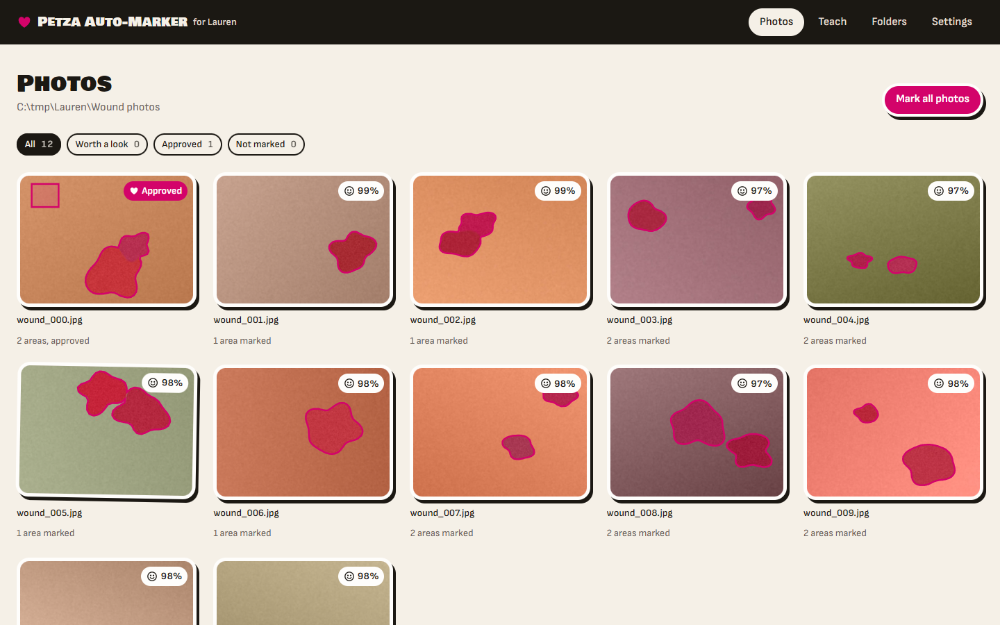
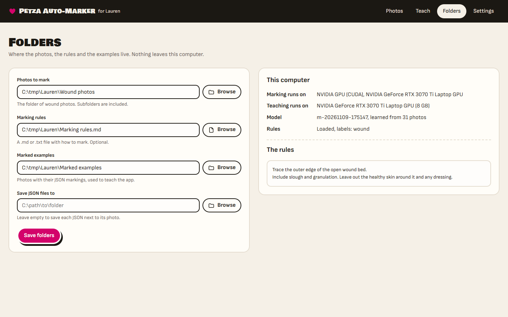
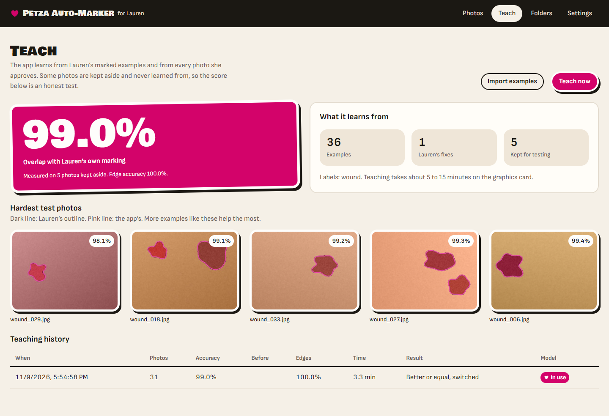
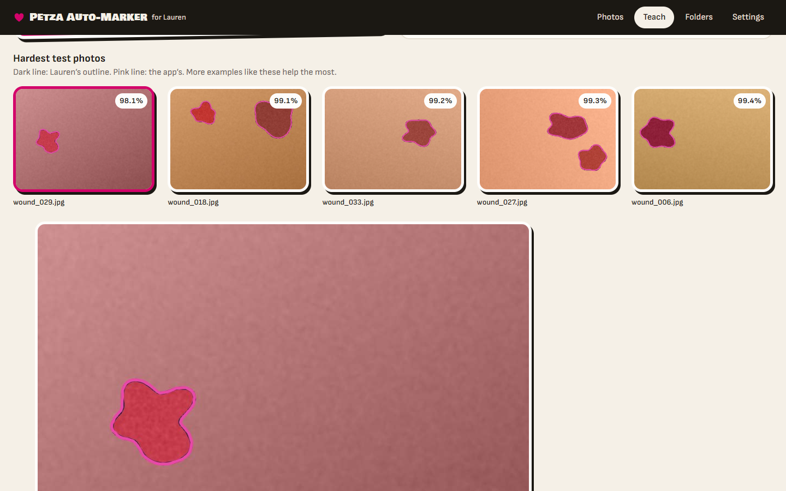
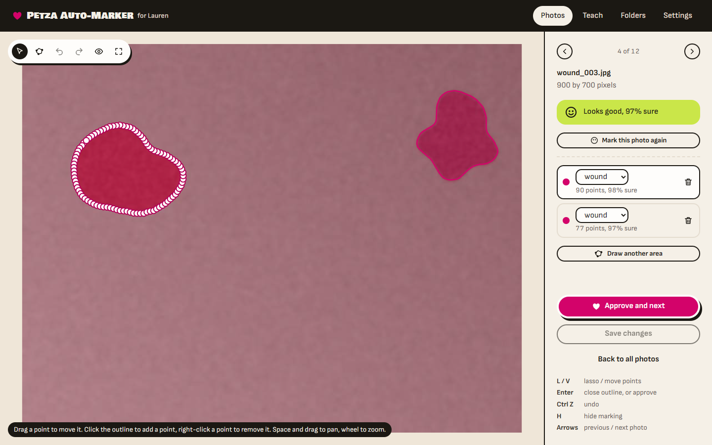
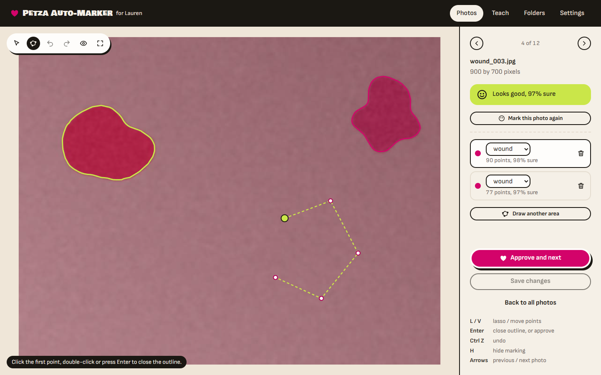
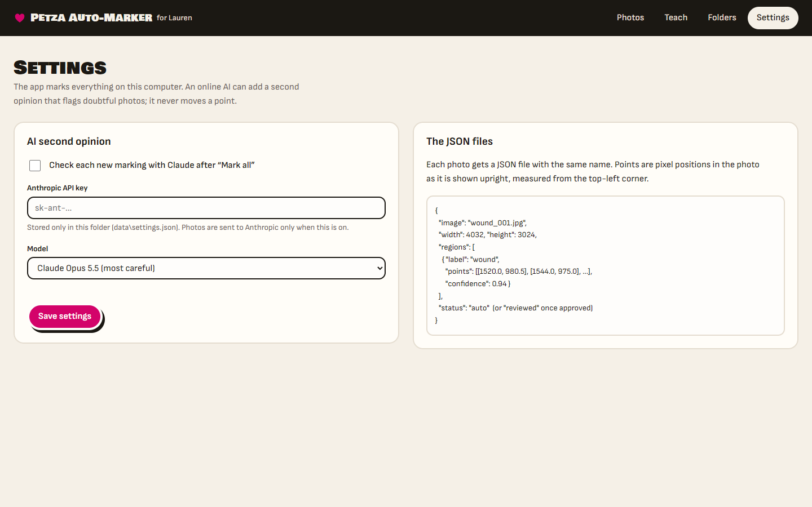

# Wound-Recognizer

היי לורן! זו התוכנה שמסמנת לבד את הפצעים בתמונות.

## מה זה?

- נותנים לתוכנה תיקייה של תמונות פצעים.
- התוכנה מציירת קו נקודות מסביב לכל פצע.
- לכל תמונה נשמר קובץ JSON עם אותו שם, מוכן להכנסה לאפליקציה הרפואית.
- התוכנה לומדת מהדוגמאות שכבר סימנת, ומכל תיקון שלך היא משתפרת.
- הכול עובד על המחשב שלך, גם בלי אינטרנט. שום תמונה לא יוצאת מהמחשב.

---

## 1. הורדה

1. נכנסים לדף הזה ב-GitHub (צריך להיות מחוברים לחשבון שקיבל גישה).
2. לוחצים על הכפתור הירוק **Code**, ואז על **Download ZIP**.
3. לוחצים על קובץ ה-ZIP עם הכפתור הימני, בוחרים **חילוץ הכל** (Extract All), ושמים את התיקייה איפה שנוח, למשל במסמכים.

## 2. התקנה (פעם אחת בלבד)

1. מתקינים את Python מהאתר: https://www.python.org/downloads/
   - **חשוב:** במסך הראשון של ההתקנה מסמנים את התיבה **Add python.exe to PATH**, ורק אז לוחצים Install.
2. נכנסים לתיקייה שחילצת ולוחצים פעמיים על **start.bat**.
3. בפעם הראשונה נפתח חלון שחור שמתקין את כל מה שצריך. זה לוקח בערך 10 עד 20 דקות וצריך אינטרנט. מחכים עד שהוא מסיים.

## 3. הפעלה (כל פעם)

1. לוחצים פעמיים על **start.bat**.
2. התוכנה נפתחת לבד בדפדפן. אם היא לא נפתחה, נכנסים לכתובת http://127.0.0.1:8765
3. **לא סוגרים את החלון השחור** כל עוד עובדים. כשמסיימים, סוגרים אותו.

---

## 4. המסך הראשון

כשהתוכנה נפתחת, רואים את מסך **Photos** עם התמונות. למעלה יש ארבעה מסכים:
**Photos** (התמונות), **Teach** (ללמד), **Folders** (תיקיות), **Settings** (הגדרות).

---

## 5. קודם כול: ללמד את התוכנה

ככל שהתוכנה לומדת מיותר דוגמאות שלך, היא מסמנת טוב יותר. לכן מתחילים מזה.

### א. בוחרים את תיקיית הדוגמאות

לוחצים למעלה על **Folders**, ובוחרים עם **Browse**:

- **Marked examples**: התיקייה של הדוגמאות שכבר סימנת.

לוחצים **Save folders**.

בצד ימין יש תיבה בשם **Marking prompt for the AI**: אלה ההוראות לבינה המלאכותית, מה נחשב פצע ומה לא (עור יבש, אזור שהחלים, עור אדום, השוליים הוורודים). כבר יש שם הוראות מוכנות בעברית.
- אפשר לערוך את הטקסט, והוא נשמר לבד.
- **Save as new**: שומרים גרסה משלך בשם חדש, ובוחרים ביניהן ברשימה.
- **Restore**: מחזירים את ההוראות המקוריות.

### ב. מלמדים

לוחצים למעלה על **Teach**.

1. לוחצים **Import examples**, והתוכנה טוענת את הדוגמאות.
2. לוחצים **Teach now**. הלמידה לוקחת בערך 5 עד 15 דקות. ההתקדמות מופיעה בפס למעלה.
3. כשהלמידה נגמרת, המספר הגדול הוא הציון: כמה הסימון של התוכנה דומה לסימון שלך, על תמונות שהתוכנה לא ראתה בזמן הלמידה.

התוכנה עוברת למודל החדש רק אם הוא טוב לפחות כמו הקודם. כדי לחזור לגרסה קודמת, לוחצים **Use this one** בטבלה שלמטה.

### ג. התמונות הכי קשות

מתחת לציון מופיעות התמונות שבהן התוכנה טעתה הכי הרבה. לוחצים על תמונה כדי לראות אותה בגדול:
**הקו הכהה** הוא הסימון שלך, ו**הקו הוורוד** הוא הסימון של התוכנה.
כדאי להוסיף עוד דוגמאות שדומות לתמונות האלה, וללחוץ שוב **Teach now**.

---

## 6. עכשיו: לסמן תמונות חדשות

### א. בוחרים את תיקיית התמונות החדשות

חוזרים ל-**Folders** ובוחרים:

- **Photos to mark**: התיקייה של התמונות החדשות, שעוד לא סומנו.
- **Save JSON files to**: איפה לשמור את קבצי ה-JSON. אם משאירים ריק, כל קובץ נשמר ליד התמונה שלו.

לוחצים **Save folders**.

### ב. מסמנים הכול

לוחצים למעלה על **Photos**, ואז על **Mark all photos**. התוכנה מסמנת את כל התיקייה ושומרת JSON לכל תמונה.

- **הסמיילי והאחוז** על כל תמונה מראים כמה התוכנה בטוחה בסימון.
- **Worth a look**: התמונות שכדאי לבדוק, כי התוכנה פחות בטוחה בהן.
- **Approved** עם לב: תמונות שאישרת. התוכנה אף פעם לא תדרוס אותן.

לוחצים על תמונה כדי לפתוח אותה לבדיקה ולתיקון.

## 7. לבדוק ולתקן תמונה

- **להזיז נקודה**: גוררים אותה עם העכבר.
- **להוסיף נקודה**: לוחצים על הקו.
- **למחוק נקודה**: לחיצה ימנית עליה.
- **למחוק אזור שלם**: לוחצים על הפח שבצד ימין.
- **זום**: גלגלת העכבר. **להזיז את התמונה**: מחזיקים רווח וגוררים.
- **בטעות?** Ctrl+Z מבטל.
- **Mark this photo again**: מסמן מחדש רק את התמונה הזו.

כשהסימון טוב, לוחצים **Approve and next** (הלב). התמונה נשמרת כמאושרת, ועוברים לתמונה הבאה.
כל תמונה שאישרת מלמדת את התוכנה בפעם הבאה שלוחצים **Teach now**.

### לצייר אזור חדש (לאסו)

אם התוכנה פספסה פצע:

1. לוחצים על **Draw another area**, או על המקש **L**.
2. לוחצים נקודה אחרי נקודה מסביב לפצע.
3. כדי לסגור את הקו, לוחצים על הנקודה הראשונה, לוחצים לחיצה כפולה, או לוחצים Enter.

## 8. הגדרות (Settings), לא חובה

אפשר לחבר בינה מלאכותית חיצונית, **Claude** או **ChatGPT**, שנותנת "דעה שנייה" ומסמנת תמונות שכדאי לבדוק. היא לא מזיזה נקודות.

1. מסמנים את התיבה הראשונה ובוחרים **Claude** או **ChatGPT**.
2. הכי פשוט: משתמשים בחשבון שכבר יש לך, בלי מפתח. צריך להתקין פעם אחת את האפליקציה הרשמית ולהתחבר אליה:
   - ל-Claude: מתקינים את **Claude Code** מהאתר הרשמי: https://code.claude.com/docs/en/setup
   - ל-ChatGPT: מתקינים את **אפליקציית Codex** מהאתר הרשמי: https://openai.com/codex/

   התוכנה מוצאת את האפליקציה לבד. אם היא לא מותקנת, מסך ההגדרות מראה קישור להורדה.
3. אם אין חשבון מחובר, אפשר במקום זה להדביק מפתח API.
4. לוחצים **Test connection** כדי לבדוק שזה עובד, ואז **Save settings**.

בלי זה הכול עובד רגיל ובלי אינטרנט.

---

## הסדר שמומלץ לעבוד בו

1. **Folders**: בוחרים את תיקיית הדוגמאות.
2. **Teach**: לוחצים Import examples ואז Teach now.
3. **Folders**: בוחרים את תיקיית התמונות החדשות.
4. **Photos**: לוחצים Mark all photos.
5. בודקים את התמונות שב-**Worth a look**, מתקנים ומאשרים עם הלב.
6. מדי פעם לוחצים שוב **Teach now**, והתוכנה משתפרת מהתיקונים שלך.

## משהו לא עובד?

- **החלון השחור נסגר מיד**: בודקים ש-Python מותקן ושסימנת את Add to PATH, ומפעילים שוב.
- **הדף לא נפתח**: בודקים שהחלון השחור פתוח, ונכנסים ל-http://127.0.0.1:8765
- **כפתור Teach now אפור**: צריך לבחור קודם תיקיית דוגמאות וללחוץ Import examples. צריך לפחות 3 דוגמאות.

---

Developer notes: [docs/DEVELOPER.md](docs/DEVELOPER.md)
