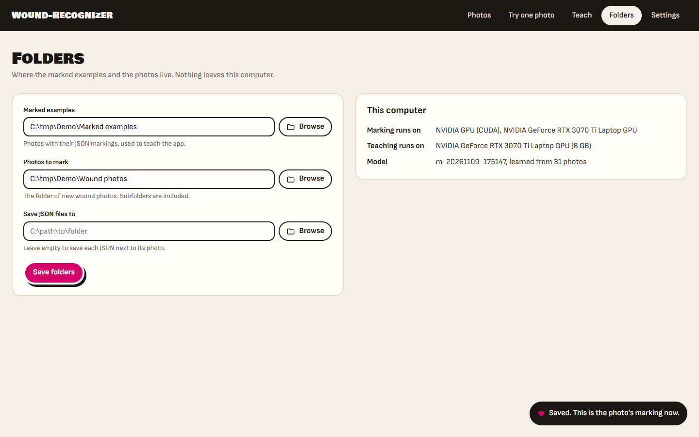
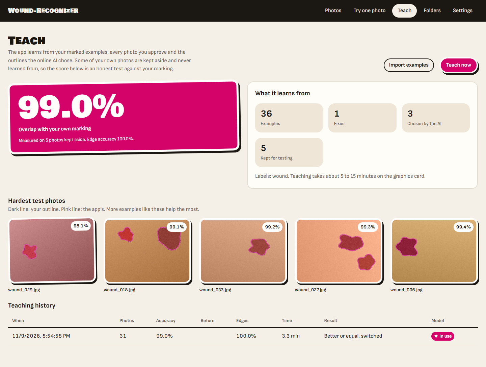

# Wound-Recognizer

## מה זה?

- נותנים לתוכנה תיקייה של תמונות פצעים.
- התוכנה מציירת קו נקודות מסביב לכל פצע.
- לכל תמונה נשמר קובץ JSON עם אותו שם, מוכן להכנסה לאפליקציה הרפואית.
- התוכנה לומדת מהדוגמאות שכבר סימנת, ומכל תיקון שלך היא משתפרת.
- הכול עובד על המחשב שלך, גם בלי אינטרנט. שום תמונה לא יוצאת מהמחשב, אלא אם מפעילים את הדעה השנייה של בינה מלאכותית.

---

## 1. הורדה

1. נכנסים לדף הזה ב-GitHub (צריך להיות מחוברים לחשבון שקיבל גישה).
2. לוחצים על הכפתור הירוק **Code**, ואז על **Download ZIP**.
3. לוחצים על קובץ ה-ZIP עם הכפתור הימני, בוחרים **חילוץ הכל** (Extract All), ושמים את התיקייה איפה שנוח, למשל במסמכים.

## 2. התקנה (פעם אחת בלבד)

1. מתקינים את Python מהאתר: https://www.python.org/downloads/
   - **חשוב:** במסך הראשון של ההתקנה מסמנים את התיבה **Add python.exe to PATH**, ורק אז לוחצים Install.
2. נכנסים לתיקייה שחילצת ולוחצים פעמיים על **start.bat**.
3. בפעם הראשונה נפתח חלון שחור שמתקין את כל מה שצריך. זה לוקח בערך 10 עד 20 דקות וצריך אינטרנט. מחכים עד שהוא מסיים.

## 3. הפעלה (כל פעם)

1. לוחצים פעמיים על **start.bat**.
2. התוכנה נפתחת לבד בדפדפן. אם היא לא נפתחה, נכנסים לכתובת http://127.0.0.1:8765
3. **לא סוגרים את החלון השחור** כל עוד עובדים. כשמסיימים, סוגרים אותו.

---

## 4. המסך הראשון

כשהתוכנה נפתחת, רואים את מסך **Photos** עם התמונות. למעלה יש ארבעה מסכים:
**Photos** (התמונות), **Teach** (ללמד), **Folders** (תיקיות), **Settings** (הגדרות).

---

## 5. קודם כול: ללמד את התוכנה

ככל שהתוכנה לומדת מיותר דוגמאות שלך, היא מסמנת טוב יותר. לכן מתחילים מזה.

### א. בוחרים את תיקיית הדוגמאות

לוחצים למעלה על **Folders**, ובשורה **Marked examples** לוחצים **Browse** ובוחרים את התיקייה של הדוגמאות שכבר סימנת. לוחצים **Save folders**.

### ב. מלמדים

לוחצים למעלה על **Teach**.

1. לוחצים **Import examples**, והתוכנה טוענת את הדוגמאות.
2. לוחצים **Teach now**. הלמידה לוקחת בערך 5 עד 15 דקות. ההתקדמות מופיעה בפס למעלה.
3. כשהלמידה נגמרת, המספר הגדול הוא הציון: כמה הסימון של התוכנה דומה לסימון שלך, על תמונות שהתוכנה לא ראתה בזמן הלמידה.

התוכנה עוברת למודל החדש רק אם הוא טוב לפחות כמו הקודם. כדי לחזור לגרסה קודמת, לוחצים **Use this one** בטבלה שלמטה.

### ג. התמונות הכי קשות

מתחת לציון מופיעות התמונות שבהן התוכנה טעתה הכי הרבה. לוחצים על תמונה כדי לראות אותה בגדול:
**הקו הכהה** הוא הסימון שלך, ו**הקו הוורוד** הוא הסימון של התוכנה.
כדאי להוסיף עוד דוגמאות שדומות לתמונות האלה, וללחוץ שוב **Teach now**.

---

## 6. עכשיו: לסמן תמונות חדשות

### א. בוחרים את תיקיית התמונות החדשות

חוזרים ל-**Folders** ובוחרים:

- **Photos to mark**: התיקייה של התמונות החדשות, שעוד לא סומנו.
- **Save JSON files to**: איפה לשמור את קבצי ה-JSON. אם משאירים ריק, כל קובץ נשמר ליד התמונה שלו.

לוחצים **Save folders**.

### ב. מסמנים הכול

לוחצים למעלה על **Photos**, ואז על **Mark all photos**. התוכנה מסמנת את כל התיקייה ושומרת JSON לכל תמונה. ההתקדמות מופיעה בפס למעלה, ואפשר לעצור עם **Stop**.

- **הסמיילי והאחוז** על כל תמונה מראים כמה התוכנה בטוחה בסימון.
- **Worth a look**: התמונות שכדאי לבדוק, כי התוכנה פחות בטוחה בהן.
- **Approved** עם לב: תמונות שאישרת. התוכנה אף פעם לא תדרוס אותן.

לוחצים על תמונה כדי לפתוח אותה לבדיקה ולתיקון.

## 7. לבדוק ולתקן תמונה

- **להזיז נקודה**: גוררים אותה עם העכבר.
- **להוסיף נקודה**: לוחצים על הקו.
- **למחוק נקודה**: לחיצה ימנית עליה.
- **למחוק אזור שלם**: לוחצים על הפח שבצד ימין.
- **זום**: גלגלת העכבר. **להזיז את התמונה**: מחזיקים רווח וגוררים.
- **בטעות?** Ctrl+Z מבטל.
- **Mark this photo again**: מסמן מחדש רק את התמונה הזו.
- **AI second opinion**: אם הדעה השנייה פעילה (ראו סעיף 8), כאן מופיע מה הבינה המלאכותית חושבת על הסימון.

כשהסימון טוב, לוחצים **Approve and next** (הלב). התמונה נשמרת כמאושרת, ועוברים לתמונה הבאה.
כל תמונה שאישרת מלמדת את התוכנה בפעם הבאה שלוחצים **Teach now**.

### לצייר אזור חדש (לאסו)

אם התוכנה פספסה פצע:

1. לוחצים על **Draw another area**, או על המקש **L**.
2. לוחצים נקודה אחרי נקודה מסביב לפצע.
3. כדי לסגור את הקו, לוחצים על הנקודה הראשונה, לוחצים לחיצה כפולה, או לוחצים Enter.

---

## 8. הגדרות (Settings), לא חובה

### דעה שנייה של בינה מלאכותית

אפשר לחבר בינה מלאכותית חיצונית שבודקת כל סימון ומסמנת תמונות שכדאי לבדוק. היא לא מזיזה נקודות. בלי זה הכול עובד רגיל ובלי אינטרנט.

1. מסמנים את התיבה הראשונה, ובוחרים **Claude**, **ChatGPT** או **Groq (free)**.
2. **Claude או ChatGPT**: משתמשים בחשבון שכבר יש לך, בלי מפתח. מתקינים פעם אחת את האפליקציה הרשמית ומתחברים אליה:
   - ל-Claude: **Claude Code** מהאתר הרשמי: https://code.claude.com/docs/en/setup
   - ל-ChatGPT: **אפליקציית Codex** מהאתר הרשמי: https://openai.com/codex/

   התוכנה מוצאת את האפליקציה לבד. אם היא לא מותקנת, מסך ההגדרות מראה קישור להורדה. אפשר גם להדביק מפתח API במקום.
3. לוחצים **Test connection** כדי לבדוק שזה עובד, ואז **Save settings**.

### Groq: חינם

Groq נותן מפתח API בחינם, בלי כרטיס אשראי:

1. נכנסים ל-https://console.groq.com/keys ונרשמים עם Google או עם כתובת מייל.
2. לוחצים **Create API Key**, נותנים לו שם כלשהו, ומעתיקים את המפתח (הוא מתחיל ב-`gsk_`).
3. בוחרים **Groq (free)** בהגדרות, מדביקים את המפתח, ולוחצים **Test connection**.

**מגבלות של התוכנית החינמית** (לפי Groq): 30 בקשות בדקה, 1,000 ביום, 8,000 טוקנים בדקה ו-200,000 ביום. כל תמונה צורכת בערך 3,000 עד 4,000 טוקנים, אז אפשר לצפות לבערך **2 תמונות בדקה** ובערך **50 תמונות ביום**. המגבלות המדויקות שלך מופיעות ב-https://console.groq.com/settings/limits

### ההוראות לבינה המלאכותית (Marking prompt for the AI)

בצד ימין של מסך ההגדרות יש תיבת טקסט בשם **Marking prompt for the AI**.

**מה זה?** אלה ההוראות שהבינה המלאכותית (Claude, ChatGPT או Groq) קוראת לפני שהיא בודקת כל סימון. לפיהן היא מחליטה אם הקו עובר במקום הנכון, ומה לכתוב לך אם משהו לא בסדר.

**חשוב לדעת:**
- ההוראות משמשות רק את **הדעה השנייה** של הבינה המלאכותית. הסימון עצמו נעשה על המחשב שלך, והוא לומד רק מהדוגמאות שסימנת, לא מהטקסט.
- אפשר לכתוב בעברית. כל שלוש הבינות המלאכותיות מבינות עברית, והתשובה שלהן תגיע באותה שפה שבה כתובות ההוראות.

**מה כתוב בהוראות המוכנות?** כבר יש הוראות מוכנות בעברית, בשם **ברירת מחדל**. הן מסבירות:
- **מה כן פצע** (בתוך הקו): רקמת גרנולציה (אדומה, לחה, גרעינית), סלאף (צהבהב, רך, סיבי), נמק (שחור או חום, יבש וקשה), וכל אזור שבו העור העליון חסר.
- **מה לא פצע** (מחוץ לקו): עור יבש ומתקלף, אזור שכבר החלים (ורוד בהיר, חלק ויבש), עור אדום אבל שלם, השוליים הוורודים החיצוניים, עור לבן ונפוח מרטיבות, ותחבושת, פלסטר או סרגל.
- **איך מבחינים ביניהם**: אם רואים קווי עור ונקבוביות, העור שלם. רקמה פתוחה לחה ומבריקה. בודקים מרקם ועומק, ולא רק צבע.
- **איך הקו צריך לעבור**: בדיוק על הגבול בין הרקמה הפתוחה לעור השלם, וכל פצע בקו נפרד.

**איך עובדים עם התיבה:**
- **לערוך**: פשוט כותבים בתיבה. השינוי נשמר לבד אחרי שנייה (מתחת לתיבה כתוב Saved in the app).
- **Save as new**: שומרים את הטקסט כגרסה חדשה בשם משלך, למשל "פצעי לחץ" או "כוויות".
- **לבחור גרסה**: ברשימה שמעל התיבה בוחרים איזו גרסה פעילה. הבינה המלאכותית משתמשת תמיד בגרסה שנבחרה.
- **Restore**: מחזיר את ברירת המחדל לטקסט המקורי.
- **Delete**: מוחק גרסה שיצרת. את ברירת המחדל אי אפשר למחוק.

**טיפים לכתיבת הוראות טובות:**
- כותבים מה נכלל ומה לא נכלל, עם דוגמאות של צבע, מרקם ולחות.
- מתארים את המקרים שבהם התוכנה טועה אצלך, למשל "השוליים הוורודים לא חלק מהפצע".
- משפטים קצרים וברורים עובדים הכי טוב.

---

## הסדר שמומלץ לעבוד בו

1. **Folders**: בוחרים את תיקיית הדוגמאות.
2. **Teach**: לוחצים Import examples ואז Teach now.
3. **Folders**: בוחרים את תיקיית התמונות החדשות.
4. **Photos**: לוחצים Mark all photos.
5. בודקים את התמונות שב-**Worth a look**, מתקנים ומאשרים עם הלב.
6. מדי פעם לוחצים שוב **Teach now**, והתוכנה משתפרת מהתיקונים שלך.

## משהו לא עובד?

- **החלון השחור נסגר מיד**: בודקים ש-Python מותקן ושסימנת את Add to PATH, ומפעילים שוב.
- **הדף לא נפתח**: בודקים שהחלון השחור פתוח, ונכנסים ל-http://127.0.0.1:8765
- **כפתור Teach now אפור**: צריך לבחור קודם תיקיית דוגמאות וללחוץ Import examples. צריך לפחות 3 דוגמאות.
- **Test connection נכשל**: ההודעה אומרת מה חסר. ב-Groq בודקים שהמפתח הועתק במלואו.

---

Developer notes: [docs/DEVELOPER.md](docs/DEVELOPER.md)
